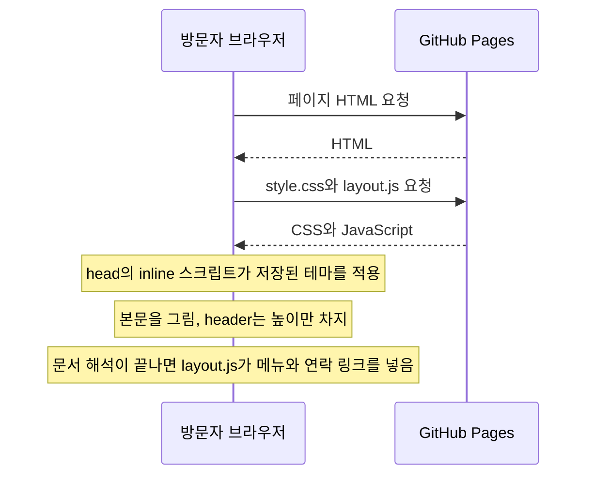
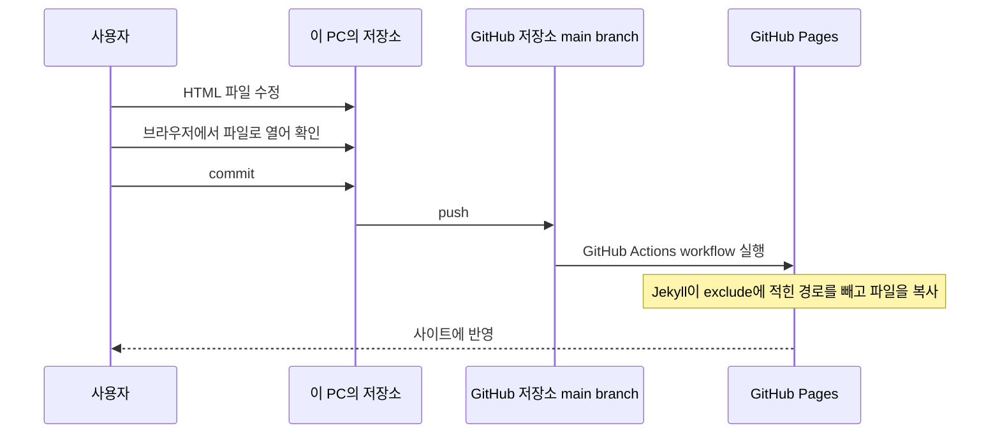
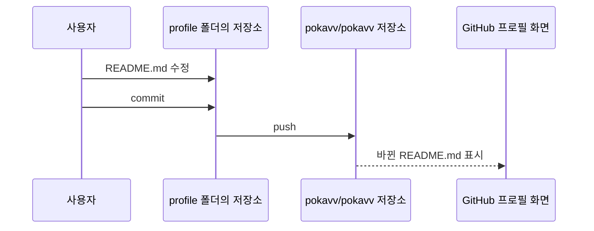

# 포트폴리오 사이트 architecture

이 문서는 docs/01-requirements.md(commit 6c1b972)에 적힌 조건을 포트폴리오 사이트가 어떤 구성으로 만족할지 정하는 architecture design 단계의 deliverable이다. deliverable은 단계마다 만들어 사용자에게 검토받는 문서다. 사이트를 이루는 파일은 빌드 도구 없이 직접 쓴 HTML, CSS, JavaScript 파일이다. 사용자가 main branch에 push하면 GitHub Pages가 저장소 루트를 배포한다. 페이지가 열리면 JavaScript 파일 하나(assets/js/layout.js)가 메뉴처럼 모든 페이지에 들어가는 부분을 넣는다.

이 문서는 1절~9절에서 결정 내용, 파일 구성, 페이지 구조, 공통 부분 삽입, 언어 전환, 테마, 처리 순서, 내용 관리, 배포를 정하고, 10절에서 requirements의 조건과 이 구성을 대응시킨다. 11절은 검토한 다른 방식을 다룬다. 이 문서에서 '사용자'는 사이트와 프로필 README를 관리하는 pokavv이고, '방문자'는 두 결과물을 보는 사람이다. 'requirements'는 docs/01-requirements.md를 가리킨다.

## 1. 결정 요약

사용자는 2026-10-26에 아래 세 가지를 정했다. 다른 방식을 검토한 내용은 11절 '검토한 다른 방식'에 있다.

1. 사이트 제작 도구: 순수 HTML. 빌드 도구 없이 HTML, CSS, JavaScript 파일을 직접 쓴다.
   - 저장소에 있는 사이트 파일이 바뀌지 않은 채 publish된다(9절 '배포와 Jekyll 처리').
   - 이 PC에 Node.js나 Ruby 같은 실행 환경이 없어도 파일을 고치고 배포할 수 있다.
   - 한국어 페이지와 영어 페이지, 프로젝트 상세 페이지를 HTML 파일로 각각 쓴다.
2. 배포 방식: 지금 방식 그대로. main branch에 push하면 GitHub Pages가 저장소 루트를 배포한다.
   - GitHub의 Pages 설정을 바꾸지 않는다.
   - 사이트 파일을 저장소 루트에 두고, 사이트가 아닌 파일을 `_config.yml`의 exclude에 적어 사이트에서 뺀다.
3. 공통 부분: JavaScript로 삽입. 메뉴, 언어 전환, 테마 전환, 하단 연락 링크의 HTML을 assets/js/layout.js가 페이지마다 넣는다.
   - 메뉴와 테마 전환 버튼을 바꿀 때는 layout.js만 고친다. 언어 전환 링크와 연락 링크는 페이지마다 있는 `<noscript>`에도 있고 연락 링크는 메인 페이지의 연락처 section에도 있으므로, 이 링크를 바꿀 때는 layout.js와 모든 HTML 파일을 함께 고친다.
   - JavaScript가 꺼진 브라우저에서는 메뉴 대신 `<noscript>` 요소 안의 언어 전환 링크와 연락 링크만 보인다.
   - layout.js가 메뉴를 나중에 넣어도 본문의 위치가 바뀌지 않도록 `<header>` 요소의 높이를 CSS로 미리 정한다.

detailed design에서 정할 것은 글꼴과 글자 크기, 색 값, 메뉴 항목(수, 이름, 문구), section id, 선택 section(글, 수상과 자격, 학력, 활동)의 위치, 화면 폭별 배치와 `<header>` 높이, 페이지마다 적는 두 값의 위치와 이름, 테마 속성과 localStorage 키의 이름, x-default 링크, rel="canonical" 링크, 외부 글꼴과 외부 스크립트를 쓸지 여부다.

## 2. 구성 요소

저장소 C:\my\portfolio(GitHub 저장소 pokavv/pokavv.github.io)는 아래 파일과 폴더로 이루어진다. 표의 `<slug>`는 프로젝트마다 붙이는 영어 이름이고, 상세 페이지의 파일 이름과 주소에 쓰인다. slug의 이름 규칙은 8절 '데이터'에 있다.

| 파일이나 폴더 | 하는 일 |
|---|---|
| `index.html` | 한국어 메인 페이지(첫 화면, 소개, 기술, 경력, 프로젝트, 연락처 section) |
| `en/index.html` | 영어 메인 페이지(index.html과 같은 section) |
| `projects/<slug>.html` | 한국어 프로젝트 상세 페이지(프로젝트 하나에 파일 하나) |
| `en/projects/<slug>.html` | 영어 프로젝트 상세 페이지 |
| `assets/css/style.css` | 모든 페이지가 함께 쓰는 CSS(두 테마의 색, `<header>` 요소의 높이) |
| `assets/js/layout.js` | 공통 부분(메뉴, 언어 전환, 테마 전환, 하단 연락 링크)의 HTML 문자열과 이를 페이지에 넣는 코드 |
| `assets/img/` | 화면 이미지 |
| `_config.yml` | GitHub Pages가 쓰는 Jekyll 설정(exclude 목록, 기본 테마를 끄는 `theme: null`) |
| `.gitignore` | git이 추적하지 않을 경로(`/profile/`) |
| `docs/` | 설계 문서(exclude로 사이트에서 빠짐) |
| `profile/` | 프로필 README 저장소 pokavv/pokavv의 로컬 사본(.gitignore로 이 저장소에서 빠짐) |

```text
C:\my\portfolio                  GitHub 저장소 pokavv/pokavv.github.io
├── index.html
├── projects/
│   └── <slug>.html
├── en/
│   ├── index.html
│   └── projects/
│       └── <slug>.html
├── assets/
│   ├── css/
│   │   └── style.css
│   ├── js/
│   │   └── layout.js
│   └── img/
├── _config.yml
├── .gitignore
├── docs/
│   ├── 01-requirements.md
│   └── 02-architecture.md
└── profile/                     git이 추적하지 않음(pokavv/pokavv의 로컬 사본)
```

사이트로 publish되는 것은 루트의 index.html과, projects/, en/, assets/ 폴더 아래의 파일이다. Jekyll은 텍스트 파일로 정적 사이트를 만드는 도구다. 이 도구는 이름이 _나 .으로 시작하는 `_config.yml`과 `.gitignore`를 빌드하지 않고, docs/는 exclude로 사이트에서 빠진다. git은 profile/을 추적하지 않으므로 이 폴더는 GitHub 저장소에 올라가지 않는다. 처리 방식은 9절 '배포와 Jekyll 처리'에 있다.

## 3. 페이지 구조

모든 페이지는 같은 공통 구조를 가진다. 아래는 한국어 상세 페이지 `projects/<slug>.html`의 예다.

```html
<!doctype html>
<html lang="ko">
<head>
  <meta charset="utf-8">
  <meta name="viewport" content="width=device-width, initial-scale=1">
  <title>페이지 제목</title>
  <meta name="description" content="페이지 설명">
  <link rel="alternate" hreflang="ko" href="https://pokavv.github.io/projects/<slug>.html">
  <link rel="alternate" hreflang="en" href="https://pokavv.github.io/en/projects/<slug>.html">
  <link rel="stylesheet" href="../assets/css/style.css">
  <script>/* 저장된 테마를 적용하는 inline 스크립트(6절) */</script>
  <script src="../assets/js/layout.js" defer></script>
</head>
<body>
  <header>
    <noscript><!-- 언어 전환 링크와 연락 링크 --></noscript>
  </header>
  <main><!-- 페이지 본문 --></main>
  <footer></footer>
</body>
</html>
```

- `<html lang>`: 값은 한국어 페이지에서 `ko`, 영어 페이지에서 `en`이다. MDN에 따르면 lang 속성은 요소의 언어를 정하는 데 쓰이고, 값은 BCP 47 언어 태그 하나다(출처: https://developer.mozilla.org/en-US/docs/Web/HTML/Reference/Global_attributes/lang). BCP 47은 IETF가 정한 언어 태그 형식이다. layout.js도 이 값으로 넣을 문자열의 언어를 고른다(4.1 '언어별 문자열').
- `<head>`: 문자 인코딩, viewport, 제목, 설명, hreflang 링크 두 개, CSS 링크, 테마 inline 스크립트, layout.js가 들어간다. viewport는 브라우저가 페이지를 그리는 화면 영역이다. hreflang 링크는 같은 내용을 다른 언어로 쓴 페이지를 검색 엔진에 알리는 `<link rel="alternate" hreflang="...">` 요소다. 제목과 설명에는 페이지마다 그 페이지의 내용을 쓴다. inline 스크립트는 별도 파일 없이 HTML 안에 직접 쓴 스크립트다. hreflang 링크의 규칙은 5절 '언어 전환 규칙'에, inline 스크립트의 동작은 6절 '테마'에 있다.
- `<body>`: `<noscript>`만 든 `<header>` 요소, 본문을 담는 `<main>` 요소, 비어 있는 `<footer>` 요소로 이루어진다. layout.js가 `<header>`와 `<footer>`에 공통 부분을 넣는다.
- `<noscript>`: MDN에 따르면 `<noscript>` 요소는 페이지의 스크립트 유형이 지원되지 않거나 브라우저에서 스크립트 실행이 꺼져 있을 때 넣을 HTML을 정한다(출처: https://developer.mozilla.org/en-US/docs/Web/HTML/Reference/Elements/noscript). `<header>` 안의 `<noscript>`에는 언어 전환 링크와 연락 링크만 둔다. JavaScript가 꺼져 있어도 `<main>`의 본문은 그대로 보인다.
- 메인 페이지의 `<main>`: requirements 3.1절 '사이트 section'의 순서대로 첫 화면, 소개, 기술, 경력, 프로젝트, 연락처 section을 둔다. 글(블로그), 수상과 자격, 학력, 활동 section은 넣을 내용이 생기면 index.html과 en/index.html에 함께 추가하고, layout.js의 두 언어 메뉴 항목에도 추가한다. 이 section의 위치는 detailed design에서 정한다.
- 상세 페이지의 `<main>`: requirements 3.2절 '프로젝트 항목'에 적힌 항목 가운데 그 프로젝트에 있는 항목을 둔다.

## 4. 공통 부분 삽입(layout.js)

layout.js는 모든 페이지에 같은 모양으로 들어가는 HTML을 문자열로 가지고 있다. 페이지가 열리면 layout.js가 이 문자열을 `<header>`와 `<footer>`에 넣는다. 넣는 내용은 아래와 같다.

- `<header>`: 메뉴, 언어 전환 링크, 테마 전환 버튼
- `<footer>`: 연락 링크. 항상 GitHub 링크를 넣고, 사용자가 이메일을 정한 경우에만 이메일도 넣는다(requirements 8절 '사용자에게 받을 내용').

### 4.1 언어별 문자열

layout.js는 한국어 문자열과 영어 문자열을 모두 가진다. 페이지의 `<html lang>` 값이 `ko`이면 한국어 문자열을, `en`이면 영어 문자열을 넣는다. detailed design에서 메뉴 항목의 이름과 문구를 정한다.

### 4.2 실행 시점

페이지는 defer 속성을 붙인 `<script>` 요소로 layout.js를 불러온다. MDN에 따르면 defer 속성이 붙은 스크립트는 문서 해석이 끝난 뒤, DOMContentLoaded 이벤트가 일어나기 전에 실행된다(출처: https://developer.mozilla.org/en-US/docs/Web/HTML/Reference/Elements/script). DOMContentLoaded는 브라우저가 HTML 해석을 마치고 defer 스크립트의 실행까지 끝낸 뒤에 일어나는 이벤트다(출처: https://developer.mozilla.org/en-US/docs/Web/HTML/Reference/Elements/script). 그래서 layout.js가 실행될 때는 `<header>`와 `<footer>` 요소가 이미 문서에 있다.

layout.js는 type="module" 속성 없이 불러온다. MDN에 따르면 모듈 스크립트를 쓰는 HTML 파일을 file:// 주소로 열면 모듈의 보안 요구 사항 때문에 CORS 오류가 난다(출처: https://developer.mozilla.org/en-US/docs/Web/JavaScript/Guide/Modules).

### 4.3 `<header>` 높이

첫 화면이 그려질 때 `<header>`에는 아직 메뉴가 없을 수 있다. 이때 layout.js가 나중에 넣은 메뉴 때문에 `<header>`가 높아지면 그 아래에 있는 본문의 위치가 아래로 바뀐다. 본문의 위치가 바뀌면 CLS(Cumulative Layout Shift) 값이 커진다. CLS는 requirements 6.2절 'Core Web Vitals'에서 0.1 이하로 정한 시각적 안정성 지표다. web.dev 문서에 따르면 layout shift는 화면에 보이는 요소의 시작 위치가 한 프레임에서 다음 프레임으로 넘어가며 바뀔 때 일어난다(출처: https://web.dev/articles/cls).

그래서 style.css는 `<header>`의 min-height를 메뉴가 가장 높아지는 경우의 높이 이상으로 지정한다. min-height는 요소의 최소 높이를 정하는 CSS 속성이다. web.dev 문서에 따르면 min-height를 지정한 요소는 안의 내용이 더 높으면 그만큼 늘어난다(출처: https://web.dev/articles/optimize-cls). 그래서 detailed design에서 메뉴가 이 높이를 넘지 않도록 메뉴 항목의 수와 글자 크기를 정한다. web.dev 문서에 따르면 나중에 삽입되는 내용의 공간을 처음 배치에서 미리 잡아 두면 layout shift를 피할 수 있다(출처: https://web.dev/articles/optimize-cls). 이 문서는 공간을 미리 잡는 방법의 하나로 min-height CSS 규칙을 든다(출처: https://web.dev/articles/optimize-cls). 화면 폭에 따라 메뉴의 높이가 달라지면 폭마다 그 폭에서 메뉴가 가장 높아지는 경우의 높이 이상을 지정한다. detailed design에서 높이 값과 화면 폭 구간을 정한다.

`<footer>`는 페이지 맨 끝에 있다. 그래서 layout.js가 연락 링크를 넣어도 그 위에 있는 요소의 위치는 바뀌지 않는다. web.dev 문서에 따르면 layout shift는 이미 있던 요소의 시작 위치가 바뀔 때만 일어난다(출처: https://web.dev/articles/cls). 같은 문서에 따르면 새 요소의 추가나 요소의 크기 변화는 화면에 보이는 다른 요소의 시작 위치를 바꾸지 않는 한 layout shift에 해당하지 않는다(출처: https://web.dev/articles/cls).

### 4.4 메뉴 링크

방문자가 메뉴 항목을 누르면 같은 언어 메인 페이지의 해당 section으로 이동한다. 메인 페이지의 section에는 각각 id를 붙인다. layout.js는 같은 언어 메인 페이지의 상대 경로 뒤에 `#`과 section id를 붙여 메뉴 링크를 만든다.

| 페이지 | 메뉴 링크 |
|---|---|
| `index.html`, `en/index.html` | `#<id>` |
| `projects/<slug>.html` | `../index.html#<id>`(index.html의 section) |
| `en/projects/<slug>.html` | `../index.html#<id>`(en/index.html의 section) |

메인 페이지에서는 메뉴 링크가 같은 페이지 안의 section을 가리킨다. detailed design에서 section id의 이름을 정한다.

### 4.5 페이지마다 적는 값

layout.js가 링크를 만들려면 페이지 위치에 따라 달라지는 값 두 개가 필요하다. 그래서 페이지마다 아래 두 값을 HTML에 적어 둔다. detailed design에서 두 값을 적는 위치와 이름을 정한다.

- 같은 언어 메인 페이지의 상대 경로: 메뉴 링크에 쓴다(4.4 '메뉴 링크').
- 다른 언어 짝 페이지의 상대 경로: 언어 전환 링크에 쓴다(5.3 '전환 링크의 상대 경로').

### 4.6 공통 HTML을 따로 받지 않는 이유

fetch는 JavaScript에서 다른 파일이나 자원을 요청해 받아 오는 API다. 이 구성은 공통 HTML을 별도 파일로 두고 fetch로 받아 오지 않고, layout.js 안에 문자열로 둔다. 그래서 공통 부분 때문에 받는 파일은 layout.js 하나뿐이다.

Fetch 표준은 file: URL의 처리를 정하지 않고 남겨 두었고, 확실하지 않으면 network error를 돌려주라고 적는다(출처: https://fetch.spec.whatwg.org/#scheme-fetch). layout.js는 fetch를 쓰지 않는다. 그래서 이 PC에서 HTML 파일을 브라우저로 바로 열어도 fetch 실패로 공통 부분이 빠지는 일은 없다. 파일로 열었을 때의 실제 동작은 구현 뒤 이 PC의 브라우저에서 확인한다.

## 5. 언어 전환 규칙

### 5.1 경로 짝

한국어 페이지의 경로 앞에 `en/`을 붙이면 짝이 되는 영어 페이지의 경로가 된다. slug는 두 언어에서 같다.

| 한국어 페이지 | 영어 페이지 |
|---|---|
| `index.html` | `en/index.html` |
| `projects/<slug>.html` | `en/projects/<slug>.html` |

언어 전환 버튼은 지금 페이지의 짝 페이지로 가는 링크다. 예를 들어 `projects/<slug>.html`의 전환 버튼은 `en/projects/<slug>.html`로 간다.

### 5.2 상대 경로

페이지 안의 링크와 CSS, JavaScript, 이미지의 경로에는 모두 상대 경로를 쓴다. 이 PC에서 HTML 파일을 브라우저로 바로 열어도 CSS, JavaScript, 이미지 파일을 찾을 수 있어야 하기 때문이다. Node.js v22.18.0의 URL 클래스로 두 종류의 경로를 해석한 결과는 아래와 같다.

| 기준 페이지 | 경로 | 해석 결과 |
|---|---|---|
| `file:///C:/my/portfolio/projects/sample.html` | `/assets/css/style.css` | `file:///C:/assets/css/style.css` |
| `file:///C:/my/portfolio/projects/sample.html` | `../assets/css/style.css` | `file:///C:/my/portfolio/assets/css/style.css` |
| `https://pokavv.github.io/projects/sample.html` | `/assets/css/style.css` | `https://pokavv.github.io/assets/css/style.css` |
| `https://pokavv.github.io/projects/sample.html` | `../assets/css/style.css` | `https://pokavv.github.io/assets/css/style.css` |

/로 시작하는 경로는 배포된 사이트에서는 맞는 파일을 가리키지만, 파일로 연 페이지에서는 드라이브 루트(C:/)를 기준으로 해석되어 저장소 밖을 가리킨다. 상대 경로는 두 경우 모두 저장소 안의 같은 파일을 가리킨다.

### 5.3 전환 링크의 상대 경로

페이지마다 짝 페이지의 상대 경로를 적어 두면(4.5 '페이지마다 적는 값'), layout.js가 이 값으로 언어 전환 링크를 만든다. `<noscript>` 안의 언어 전환 링크에도 같은 경로를 쓴다.

| 페이지 | 짝 페이지의 상대 경로 |
|---|---|
| `index.html` | `en/index.html` |
| `en/index.html` | `../index.html` |
| `projects/<slug>.html` | `../en/projects/<slug>.html` |
| `en/projects/<slug>.html` | `../../projects/<slug>.html` |

### 5.4 hreflang 링크

모든 페이지의 `<head>`에는 한국어 페이지와 영어 페이지를 가리키는 링크 두 개를 넣고, 두 링크 가운데 하나는 그 페이지 자신을 가리킨다. hreflang 값은 `<html lang>`과 같은 `ko`와 `en`이다. 링크의 href에는 `https://pokavv.github.io`로 시작하는 전체 주소를 쓴다. 메인 페이지의 주소는 `https://pokavv.github.io/`와 `https://pokavv.github.io/en/`이다.

언어 전환 링크와 메뉴 링크는 파일로 열 때도 동작하도록 index.html까지 적으므로, 배포된 사이트에서는 `https://pokavv.github.io/en/index.html`처럼 hreflang 링크와 다른 주소로 간다. rel="canonical"을 둘지는 detailed design에서 정한다.

Google 검색 문서에 따르면 각 언어 버전은 자기 자신과 다른 모든 언어 버전을 나열해야 하고, 다른 버전의 주소는 http나 https를 포함한 전체 주소여야 한다(출처: https://developers.google.com/search/docs/specialty/international/localized-versions). 또 두 페이지가 서로를 가리키지 않으면 그 태그는 무시된다(출처: https://developers.google.com/search/docs/specialty/international/localized-versions). 이 문서는 어느 언어에도 맞지 않는 방문자를 위한 대체 페이지를 x-default 값으로 두는 것을 고려하라고 권하고, 특히 언어나 국가를 고르는 페이지와 자동으로 redirect하는 홈페이지를 그 대상으로 든다(출처: https://developers.google.com/search/docs/specialty/international/localized-versions). detailed design에서 x-default 링크를 넣을지 정한다.

## 6. 테마

### 6.1 CSS 변수

MDN에 따르면 custom properties는 CSS 작성자가 정의해서 문서 전체에서 다시 쓰는 특정한 값을 나타내고, CSS 변수라고도 부른다(출처: https://developer.mozilla.org/en-US/docs/Web/CSS/Guides/Cascading_variables/Using_custom_properties). style.css는 배경색과 글자색 같은 색을 CSS 변수로 정의하고, 밝은 테마와 어두운 테마에서는 변수의 값만 바꾼다. detailed design에서 색 값을 정한다.

### 6.2 운영 체제 설정

MDN에 따르면 prefers-color-scheme은 사용자가 밝은 색 테마나 어두운 색 테마를 요청했는지 알아내는 CSS media feature이고, 사용자는 운영 체제 설정이나 브라우저 설정으로 이 선호를 나타낸다(출처: https://developer.mozilla.org/en-US/docs/Web/CSS/Reference/At-rules/@media/prefers-color-scheme). 저장된 테마가 없으면 style.css의 prefers-color-scheme 미디어 쿼리가 테마를 정한다. 미디어 쿼리는 화면 폭이나 사용자 설정 같은 조건에 따라 CSS 규칙을 적용하는 문법이다. 이 규칙은 CSS만으로 동작한다. 그래서 JavaScript가 꺼져 있어도 운영 체제 설정에 맞는 테마가 보인다.

### 6.3 전환과 저장

layout.js가 `<header>`에 테마 전환 버튼을 넣는다. 방문자가 이 버튼을 누르면 layout.js가 테마를 바꾼다. 이때 layout.js는 고른 테마를 localStorage에도 저장한다. localStorage는 브라우저가 origin마다 값을 저장해 두는 저장소이고, origin은 scheme, 호스트, 포트의 조합이다.

MDN에 따르면 localStorage에 접근할 때 SecurityError가 발생하는 경우는 두 가지다. 하나는 origin이 올바른 scheme, 호스트, 포트 조합이 아닌 경우이고(예: file:이나 data: scheme을 쓰는 origin), 다른 하나는 사용자가 페이지의 데이터 저장을 막도록 브라우저를 설정한 경우다(출처: https://developer.mozilla.org/en-US/docs/Web/API/Window/localStorage). 같은 문서에 따르면 file: URL로 연 문서에서 localStorage가 어떻게 동작해야 하는지는 정해져 있지 않고, 브라우저마다 다를 수 있다(출처: https://developer.mozilla.org/en-US/docs/Web/API/Window/localStorage).

같은 문서에 따르면 지금의 브라우저는 file: URL마다 별도의 localStorage를 쓰는 것으로 보이지만 이 동작은 보장되지 않는다(출처: https://developer.mozilla.org/en-US/docs/Web/API/Window/localStorage). 따라서 HTML 파일을 브라우저로 바로 열어 확인할 때는 한 페이지에서 고른 테마가 다른 페이지에 적용되지 않을 수 있다.

localStorage에 접근할 때 SecurityError가 날 수 있으므로, inline 스크립트와 layout.js는 localStorage를 읽고 쓰는 코드를 모두 `try...catch`로 감싼다. `try...catch`는 오류가 나도 스크립트가 멈추지 않도록 오류를 받아 처리하는 JavaScript 문법이다. 읽기에 실패하면 운영 체제 설정에 따른 테마를 보여 준다. 쓰기에 실패하면 고른 테마를 지금 페이지에만 적용한다. 어느 경우에도 화면은 정상으로 보인다.

### 6.4 첫 화면 깜빡임

저장된 테마가 운영 체제 설정과 다를 때가 있다. 이때 본문이 운영 체제 설정의 색으로 먼저 그려진 뒤 저장된 테마의 색으로 다시 그려지는 현상을 첫 화면 깜빡임이라고 한다. 이를 막기 위해 `<head>` 안의 inline 스크립트가 저장된 테마를 읽어 `<html>` 요소의 속성으로 표시한다. style.css는 이 속성이 있으면 미디어 쿼리보다 이 속성의 테마를 우선한다.

MDN에 따르면 type="module" 속성이 없는 inline 스크립트는 브라우저가 페이지 해석을 이어 가기 전에 바로 실행된다(출처: https://developer.mozilla.org/en-US/docs/Web/HTML/Reference/Elements/script). 그래서 `<body>`가 해석되기 전에 테마가 정해진다. inline 스크립트는 모든 페이지에 같은 내용으로 들어간다. detailed design에서 속성의 이름과 localStorage 키의 이름을 정한다.

## 7. 순서

이 절의 그림은 Markdown 파일 안에 mermaid 문법으로 쓴 sequence diagram이다. GitHub 문서에 따르면 GitHub는 Markdown 파일에서 mermaid 문법으로 쓴 그림을 그려 보여 주고, mermaid는 sequence diagram을 그릴 수 있다(출처: https://docs.github.com/en/get-started/writing-on-github/working-with-advanced-formatting/creating-diagrams).

### 7.1 방문자가 페이지를 여는 순서



본문은 layout.js를 기다리지 않고 그려진다. 메뉴는 `<header>`에 미리 잡아 둔 높이 안에 들어간다(4.2 '실행 시점', 4.3 '`<header>` 높이').

### 7.2 내용을 고쳐 배포하는 순서



GitHub 문서에 따르면 source branch에 push하면 source folder에서 바뀐 내용이 GitHub Pages 사이트에 publish된다(출처: https://docs.github.com/en/pages/getting-started-with-github-pages/configuring-a-publishing-source-for-your-github-pages-site). 같은 문서에 따르면 GitHub Pages 사이트는 항상 GitHub Actions workflow 실행으로 배포된다(출처: https://docs.github.com/en/pages/getting-started-with-github-pages/configuring-a-publishing-source-for-your-github-pages-site). 또 GitHub 문서에 따르면 push한 변경이 사이트에 publish되기까지 최대 10분이 걸릴 수 있다(출처: https://docs.github.com/en/pages/getting-started-with-github-pages/creating-a-github-pages-site).

### 7.3 프로필 README를 고치는 순서



profile/은 사이트 저장소와 별개인 pokavv/pokavv 저장소의 로컬 사본이다. 사용자는 이 폴더에서 만든 commit을 pokavv/pokavv로 push한다. 프로필 README가 표시되는 조건은 requirements 1.2절 'GitHub 프로필 README'에 있다.

## 8. 데이터

사용자는 사이트의 내용을 HTML 파일 안에 직접 쓰고, JSON이나 Markdown 같은 별도 데이터 파일을 두지 않는다.

### 8.1 프로젝트 내용이 들어가는 곳

프로젝트 하나의 내용은 아래 다섯 곳에 나뉘어 들어간다.

| 위치 | 들어가는 항목 |
|---|---|
| `index.html`의 프로젝트 section 카드 | 이름, 한 줄 설명, 쓴 기술, 상태 |
| `en/index.html`의 프로젝트 section 카드 | 위 항목의 영어판 |
| `projects/<slug>.html` | requirements 3.2절 '프로젝트 항목'의 항목 |
| `en/projects/<slug>.html` | 위 항목의 영어판 |
| 프로필 README(대표 프로젝트인 경우) | 이름, 한 줄 설명, 사이트의 상세 페이지 링크 |

카드에 넣는 네 가지는 requirements 3.2절 '프로젝트 항목'이 프로젝트 목록에 정한 항목이다. 프로필 README에 넣는 내용은 requirements 3.3절 '프로필 README'를 따른다.

### 8.2 짝을 맞추는 규칙

- 한 곳을 고치면 짝이 되는 곳도 같이 고친다.
- 한국어 문장을 고치면 같은 위치의 영어 문장도 고친다. 영어 문장을 먼저 고칠 때도 같다.
- 이름, 한 줄 설명, 쓴 기술, 상태는 메인 페이지 카드와 상세 페이지에 모두 있다. 이 네 항목을 고치면 index.html, en/index.html과 두 상세 페이지를 함께 고친다.
- 대표 프로젝트의 이름이나 한 줄 설명을 고치면 프로필 README도 고친다.
- 메인 페이지의 다른 section도 index.html과 en/index.html의 짝을 맞춘다.
- push하기 전에 projects/와 en/projects/의 파일 이름 목록이 같은지 확인한다. 저장소 루트에서 Git Bash로 `diff <(command ls projects) <(command ls en/projects)`를 실행해 아무것도 출력되지 않으면 짝이 맞다. 짝 페이지가 없으면 언어 전환 링크가 404 페이지로 가고, Google은 서로를 가리키지 않는 hreflang 링크를 무시한다(출처: https://developers.google.com/search/docs/specialty/international/localized-versions).

### 8.3 slug 이름 규칙

- slug에는 영어 소문자(a~z), 숫자(0~9), 하이픈(-)만 쓴다.
- slug는 하이픈으로 시작하거나 끝나지 않고, slug 안에서 하이픈이 두 개 이어지지 않는다.
- 위 두 규칙을 정규식으로 쓰면 `^[a-z0-9]+(-[a-z0-9]+)*$`이다. 예를 들어 `portfolio-site`와 `3d-viewer`는 규칙에 맞고, `-abc`, `abc-`, `a--b`, `ABC`는 맞지 않는다.
- 한 프로젝트의 slug는 두 언어에서 같다.
- slug는 상세 페이지의 파일 이름(`projects/<slug>.html`, `en/projects/<slug>.html`)과 주소에 그대로 들어간다.

## 9. 배포와 Jekyll 처리

### 9.1 GitHub Pages의 Jekyll 처리

GitHub 문서에 따르면 source branch에서 사이트를 publish하면 GitHub Pages는 기본으로 Jekyll을 써서 사이트를 빌드한다(출처: https://docs.github.com/en/pages/getting-started-with-github-pages/creating-a-github-pages-site). publishing source는 GitHub Pages가 사이트로 publish하는 branch와 폴더이고, 이 저장소의 Pages 설정은 main branch의 루트를 가리킨다. 그래서 push할 때마다 Jekyll이 저장소 루트를 처리한다.

### 9.2 front matter가 없는 HTML 파일

front matter는 파일 맨 앞에 대시 세 개(---)로 된 두 줄 사이에 YAML 형식으로 쓰는 설정이다. Jekyll 문서에 따르면 Jekyll은 YAML front matter가 있는 파일을 특별한 파일로 처리하고, front matter는 파일의 맨 앞에 와야 한다(출처: https://jekyllrb.com/docs/front-matter/). Jekyll의 Static Files 문서에 따르면 front matter가 없는 파일은 static file이고, 이미지와 PDF처럼 변환하지 않는 내용이 여기에 해당한다(출처: https://jekyllrb.com/docs/static-files/). Directory Structure 문서는 그 문서의 표에 적은 특별한 경우를 빼면 css 폴더와 images 폴더 같은 나머지 폴더와 파일이 생성된 사이트에 그대로 복사된다고 설명한다(출처: https://jekyllrb.com/docs/structure/).

이 사이트의 HTML, CSS, JavaScript, 이미지 파일에는 front matter를 넣지 않는다. 따라서 Jekyll은 이 파일을 바꾸지 않고 사이트에 복사한다.

GitHub Pages가 쓰는 github-pages gem은 `_config.yml`에 theme가 없으면 jekyll-theme-primer를 기본 테마로 쓴다(출처: https://raw.githubusercontent.com/github/pages-gem/v232/lib/github-pages/configuration.rb). Jekyll 문서에 따르면 테마의 assets 폴더에 있는 파일은 front matter가 있으면 변환되어 사이트에 들어간다(출처: https://jekyllrb.com/docs/themes/). jekyll-theme-primer의 `assets/css/style.scss`에는 front matter가 있으므로 `assets/css/style.css`가 만들어지고, 이 경로는 이 사이트의 `assets/css/style.css`와 같다(출처: https://raw.githubusercontent.com/pages-themes/primer/master/assets/css/style.scss). 그래서 `_config.yml`에 `theme: null`을 적어 기본 테마를 끈다. github-pages gem은 사용자가 theme에 null을 적으면 그 값을 그대로 써서 테마를 끈다(출처: https://raw.githubusercontent.com/github/pages-gem/v232/lib/github-pages/configuration.rb). `theme: null` 줄은 구현 단계에서 `_config.yml`에 넣는다.

### 9.3 front matter가 없는 Markdown 파일

GitHub 문서에 따르면 GitHub Pages는 기본으로 켜져 있고 끌 수 없는 plugin을 쓰며, jekyll-optional-front-matter가 그 plugin 가운데 하나다(출처: https://docs.github.com/en/pages/setting-up-a-github-pages-site-with-jekyll/about-github-pages-and-jekyll). 이 plugin의 README에 따르면 사이트 source에 있는 Markdown 파일은 YAML front matter가 없어도 페이지로 다루어져 HTML로 바뀌고, 기본 설정에서는 원래 Markdown 파일도 결과물에 함께 들어간다(출처: https://github.com/benbalter/jekyll-optional-front-matter). 같은 README에 따르면 이 plugin은 README, CONTRIBUTING, CODE_OF_CONDUCT, LICENSE 같은 파일을 페이지로 바꾸지 않는다(출처: https://github.com/benbalter/jekyll-optional-front-matter). 이런 파일은 front matter가 없는 static file이다(출처: https://jekyllrb.com/docs/static-files/). Directory Structure 문서에 따르면 그 문서의 표에 적은 특별한 경우가 아닌 파일은 생성된 사이트에 그대로 복사된다(출처: https://jekyllrb.com/docs/structure/). 그래서 Markdown 파일을 저장소에 두면, exclude에 적지 않은 경우 그 파일은 HTML 페이지나 원래 Markdown 파일의 형태로 사이트에 publish된다.

### 9.4 exclude 규칙

Jekyll 문서에 따르면 exclude 설정으로 폴더와 파일을 변환에서 뺄 수 있다(출처: https://jekyllrb.com/docs/configuration/options/). GitHub 문서에 따르면 Jekyll은 기본으로 /node_modules나 /vendor 폴더 안의 파일, 이름이 `_`, `.`, `#` 가운데 하나로 시작하는 파일과 폴더, 이름이 `~`로 끝나는 파일과 폴더, exclude 설정에 적힌 파일과 폴더를 빌드하지 않는다(출처: https://docs.github.com/en/pages/setting-up-a-github-pages-site-with-jekyll/about-github-pages-and-jekyll). 다만 Jekyll 문서에 따르면 Jekyll 3에서는 사용자가 적은 exclude가 기본 제외 목록을 대신한다(출처: https://jekyllrb.com/docs/configuration/options/). GitHub Pages는 Jekyll 3.10.0을 쓰므로(출처: https://pages.github.com/versions.json), exclude를 적은 이 저장소에서는 node_modules와 vendor도 exclude에 적어야 빠진다. 그래서 아래 규칙을 지킨다.

- 사이트가 아닌 파일이나 폴더를 저장소에 추가할 때마다 `_config.yml`의 exclude에도 추가한다. Jekyll 문서에 따르면 exclude의 항목은 사이트 source 폴더를 기준으로 한 경로이고, 이 저장소에서는 저장소 루트가 기준이다(출처: https://jekyllrb.com/docs/configuration/options/). 그래서 하위 폴더의 파일은 `assets/img/notes.md`처럼 루트부터 경로를 적는다. 같은 문서는 여러 폴더의 README.md를 함께 빼는 예로 `README.md`와 `**/README.md`를 함께 적는다(출처: https://jekyllrb.com/docs/configuration/options/). 지금 exclude에는 docs가 있다.
- 이름이 `_`, `.`, `#`로 시작하거나 `~`로 끝나는 파일과 폴더는 exclude에 적지 않아도 빌드되지 않는다(출처: https://docs.github.com/en/pages/setting-up-a-github-pages-site-with-jekyll/about-github-pages-and-jekyll). 그래서 `_config.yml`과 `.gitignore`는 publish되지 않고, 사이트 파일과 폴더에는 이런 이름을 쓰지 않는다.

### 9.5 .nojekyll을 넣지 않는 이유

GitHub 문서에 따르면 source branch에서 사이트를 publish할 때 publishing source의 루트에 빈 .nojekyll 파일을 만들면 Jekyll 빌드를 끌 수 있다(출처: https://docs.github.com/en/pages/getting-started-with-github-pages/creating-a-github-pages-site). 같은 문서 모음에 따르면 대부분의 외부 CI(continuous integration) workflow는 빌드 결과를 gh-pages branch에 commit하면서 .nojekyll 파일을 넣는다. 이때 GitHub Actions workflow는 그 branch에 빌드 단계가 필요 없다고 판단하고, 배포에 필요한 단계만 실행한다(출처: https://docs.github.com/en/pages/getting-started-with-github-pages/configuring-a-publishing-source-for-your-github-pages-site).

exclude는 Jekyll이 변환할 때 적용하는 설정이다. 그래서 .nojekyll로 Jekyll 빌드를 끄면 exclude도 적용되지 않는다. 그러면 루트의 docs/가 그대로 사이트에 publish된다. 공식 문서에서 이 결론을 직접 적은 문장을 찾지 못했다. 이 결론은 위 문단의 GitHub 문서 내용과 9.4 'exclude 규칙'의 설명을 합친 추론이다. 이 추론에 따라 이 저장소에는 .nojekyll을 넣지 않는다.

### 9.6 사이트 크기와 대역폭

requirements 4절 'Scale'은 배포할 때마다 사이트 파일의 전체 크기를 확인하게 하고, 대역폭 사용량을 확인하는 방법을 architecture design에서 정하게 했다. 이 절은 두 가지를 확인하는 방법을 정한다.

GitHub 문서에 따르면 publish된 GitHub Pages 사이트는 1 GB보다 클 수 없고, GitHub Pages 사이트의 대역폭에는 월 100 GB의 soft limit이 있다(출처: https://docs.github.com/en/pages/getting-started-with-github-pages/github-pages-limits). 같은 문서에 따르면 사이트가 이 한도를 넘으면 GitHub가 사이트를 제공하지 못할 수 있다(출처: https://docs.github.com/en/pages/getting-started-with-github-pages/github-pages-limits). 또는 GitHub Support가 사이트 때문에 GitHub 서버에 생기는 부하를 줄이는 방법을 이메일로 안내할 수 있다(출처: https://docs.github.com/en/pages/getting-started-with-github-pages/github-pages-limits).

사용자는 push하기 전에 사이트 크기를 확인한다. publish되는 것은 루트의 index.html과, en/, projects/, assets/ 폴더 아래의 파일이다(2절 '구성 요소'). 저장소 루트(C:\my\portfolio)에서 Git Bash로 아래 명령을 실행하면 마지막 줄에 이 파일 전체의 바이트 단위 합계가 나온다.

```bash
du -cb index.html en projects assets | tail -n 1
```

Git Bash에 있는 du(GNU coreutils 8.32)의 도움말에 따르면 `-b`는 `--apparent-size --block-size=1`과 같고, `-c`는 전체 합계를 낸다. GitHub 문서는 1 GB가 몇 바이트인지 적지 않았다. 그래서 합계가 1,000,000,000바이트 이하인지 본다. 1 GB를 1,073,741,824바이트로 보아도 이 기준을 지키면 한도 안에 든다.

이 문서를 쓸 때 GitHub 화면에서 Pages의 대역폭 사용량을 보여 주는 기능을 확인하지 못했다. 그래서 대역폭은 따로 재지 않고, 한도를 넘었을 때 GitHub Support가 보낼 수 있는 이메일로 확인한다.

같은 문서에 따르면 한도를 넘으면 이메일 없이 사이트 제공이 멈출 수도 있다(출처: https://docs.github.com/en/pages/getting-started-with-github-pages/github-pages-limits). 그래서 사이트가 열리지 않으면 대역폭 한도도 원인으로 확인한다. 또 같은 문서에 따르면 custom GitHub Actions workflow를 쓰지 않는 사이트에는 시간당 10번의 빌드 soft limit이 있다(출처: https://docs.github.com/en/pages/getting-started-with-github-pages/github-pages-limits). docs/만 고친 commit도 source branch인 main에 push하면 GitHub Pages가 빌드를 실행한다(출처: https://docs.github.com/en/pages/getting-started-with-github-pages/configuring-a-publishing-source-for-your-github-pages-site).

## 10. requirements 대응

아래 네 목록은 requirements 5절 'Security', 6절 'Performance targets', 7절 'Constraints', 4절 'Scale'의 항목마다 이 구성에서 만족하는 방법을 보여 준다. requirements 3절 '보여 줄 내용'의 화면 구성은 3절 '페이지 구조'와 8절 '데이터'가 다룬다. 측정해야 알 수 있는 항목에는 '구현 뒤 측정'이라고 적는다.

### 10.1 Security

- secret 금지: 빌드는 GitHub Pages가 실행하는 Jekyll 빌드뿐이고 서버 프로그램과 저장소의 workflow 파일을 두지 않으므로 secret이 필요하지 않다.
- 비공개 저장소의 코드, 내부 문서 원문, 저장소 링크 금지와 공개 범위: 사이트의 내용은 모두 HTML 본문에 있으므로, commit 전에 git diff로 바뀐 내용을 확인할 수 있다. 내용의 출처는 requirements 3.4절 '내용 출처'를 따른다.
- 회사 내부 정보 금지: 위 항목과 같은 방법으로 확인한다.
- 전화번호와 집 주소 금지, 사용자가 정한 이메일만 공개: 이메일은 사용자가 정한 경우에만 layout.js, 메인 페이지의 연락처 section, 페이지마다 있는 `<noscript>`에 넣는다. 전화번호와 집 주소는 넣지 않는다.
- commit의 author와 committer: 이 구성과 관계없이 commit할 때 pokavv의 noreply 주소를 지정한다.
- 방문자 추적 스크립트, 외부 analytics, 광고 금지: 이 문서가 정한 스크립트는 테마 inline 스크립트와 layout.js뿐이다. 외부 글꼴과 외부 스크립트를 쓸지는 detailed design에서 정한다.
- 프로필 README의 외부 이미지: 사이트 구성과 관계없이, 프로필 README를 쓸 때 requirements 3.3절 '프로필 README'를 따른다.

### 10.2 Performance targets

- Lighthouse 모바일 점수 4개의 중앙값이 각각 90 이상(requirements 6.1절 'Lighthouse 점수'): 구현 뒤 측정한다. 영어 페이지는 en/ 아래의 다른 주소이므로 영어 페이지도 측정한다.
- LCP(Largest Contentful Paint) 중앙값 2.5초 이내(requirements 6.2절 'Core Web Vitals'): 구현 뒤 측정한다.
- CLS 중앙값 0.1 이하(requirements 6.2절 'Core Web Vitals'): `<header>`의 높이를 CSS로 미리 지정하므로 layout.js가 메뉴를 넣어도 본문의 위치가 바뀌지 않는다(4.3 '`<header>` 높이'). 수치는 구현 뒤 측정한다.
- TBT(Total Blocking Time) 중앙값 200 ms 이하(requirements 6.2절 'Core Web Vitals'): 스크립트는 테마 inline 스크립트와 defer로 불러오는 layout.js뿐이다. 수치는 구현 뒤 측정한다.
- CrUX(Chrome User Experience Report) 데이터가 있을 때의 75th percentile 값(requirements 6.2절 'Core Web Vitals'): 구현 뒤 측정한다.

### 10.3 Constraints

- GitHub 요금제에 따른 공개 저장소: 공개 저장소 pokavv/pokavv.github.io를 그대로 쓴다.
- 정적 사이트: HTML, CSS, JavaScript, 이미지 파일만 배포하고 서버 프로그램과 데이터베이스는 두지 않는다.
- 사이트 파일만 publish하고 docs/는 저장소에만 두는 publish 범위: `_config.yml`의 exclude로 docs/를 뺀다. 사이트가 아닌 파일을 추가할 때마다 exclude에도 추가한다(9.4 'exclude 규칙').
- 비용 0원: GitHub Pages와 GitHub가 실행하는 배포 workflow만 쓴다. GitHub 문서에 따르면 공개 저장소에서 GitHub Actions는 무료다(출처: https://docs.github.com/en/pages/getting-started-with-github-pages/creating-a-github-pages-site).
- 화면 폭 360px~1920px에서 가로 스크롤 없음: detailed design에서 CSS 배치를 정하고 구현 뒤 확인한다.
- 밝은 테마와 어두운 테마, 기본값은 운영 체제 설정: CSS 변수, prefers-color-scheme, 테마 전환 버튼, localStorage로 만족한다(6절 '테마').
- 한국어와 영어, 언어 전환 버튼, 모든 글을 두 언어로 작성, 처음 열면 한국어: 루트의 index.html이 한국어 메인 페이지이고 영어 페이지는 en/ 아래에 있다. 언어 전환 버튼은 짝 페이지로 가는 링크다(5절 '언어 전환 규칙'). 두 언어의 짝은 8.2 '짝을 맞추는 규칙'으로 맞춘다.
- 지원 브라우저: 구현 뒤 확인하고 확인한 브라우저와 버전을 결과와 함께 기록한다.

### 10.4 Scale

- 사이트 파일 전체 크기 1 GB 이하, 배포할 때마다 확인: push하기 전에 du로 사이트 파일의 바이트 합계를 확인한다(9.6 '사이트 크기와 대역폭').
- 대역폭 사용량 확인 방법: 따로 재지 않고 GitHub Support 이메일로 확인한다(9.6 '사이트 크기와 대역폭').
- 소개할 프로젝트 3~5개: 프로젝트마다 상세 페이지 두 개와 메인 페이지 카드 두 개를 둔다(8.1 '프로젝트 내용이 들어가는 곳').

## 11. 검토한 다른 방식

architecture design 단계에서 사이트 제작 도구 네 가지와 공통 부분을 넣는 방식을 검토했다. 사이트 제작 도구를 비교할 때는 각 도구의 공식 문서를 근거로 삼았다. 그 결과 Astro가 두 언어와 내용 파일을 공식 기능으로 지원해서 추천안이 됐다. 그러나 사용자는 빌드 도구가 없는 순수 HTML을 골랐다.

- Astro: Astro 문서에 따르면 Astro의 i18n routing은 기본 언어 설정을 포함한 다국어 내용을 지원하고, prefixDefaultLocale의 기본값에서는 기본 언어의 주소에 언어 접두사가 붙지 않는다(출처: https://docs.astro.build/en/guides/internationalization/). Astro 문서에 따르면 사이트 작성자는 content collections로 Markdown 파일 묶음 같은 내용을 관리할 수 있다(출처: https://docs.astro.build/en/guides/content-collections/). Astro는 기본으로 모든 UI 컴포넌트를 HTML과 CSS로만 렌더링하고 client-side JavaScript를 넣지 않는다(출처: https://docs.astro.build/en/concepts/islands/). Astro 사이트는 GitHub Actions로 GitHub Pages에 배포된다(출처: https://docs.astro.build/en/guides/deploy/github/). Astro에는 Node.js v22.23.4 이상이 필요하다(출처: https://docs.astro.build/en/install-and-setup/).
- Next.js static export: Next.js 문서에 따르면 next.config.js의 output을 'export'로 바꾸면 static export가 켜진다(출처: https://nextjs.org/docs/app/guides/static-exports). 같은 문서 모음에 따르면 Pages Router의 Internationalized Routing은 output: 'export'와 통합되지 않는다(출처: https://nextjs.org/docs/pages/guides/internationalization). App Router 문서는 locale에 따른 redirect를 Proxy에서 처리하는 방법을 설명하고(출처: https://nextjs.org/docs/app/guides/internationalization), static export 문서는 지원하지 않는 기능 목록에 Proxy를 넣었다(출처: https://nextjs.org/docs/app/guides/static-exports). Next.js에는 Node.js 20.9 이상이 필요하다(출처: https://nextjs.org/docs/app/getting-started/installation).
- Hugo: Hugo 문서에 따르면 Hugo의 multilingual mode는 언어와 지역마다 번역을 포함한 내용을 현지화할 수 있게 한다(출처: https://gohugo.io/content-management/multilingual/). Hugo는 defaultContentLanguageInSubdir의 기본값 false에서 기본 언어를 언어 이름의 하위 폴더에 publish하지 않는다(출처: https://gohugo.io/configuration/all/). Hugo의 GitHub Pages 안내는 Pages의 Source를 GitHub Actions로 바꾸고 workflow로 배포하는 방법을 설명한다(출처: https://gohugo.io/host-and-deploy/deploy-to-github-pages/). Hugo로 빌드하려면 사용자가 이 PC에 Hugo를 설치해야 하고, Hugo 문서는 Windows에 Hugo를 설치하는 방법을 안내한다(출처: https://gohugo.io/installation/windows/).
- Jekyll: GitHub Pages는 source branch에서 publish할 때 기본으로 Jekyll로 빌드한다(9.1 'GitHub Pages의 Jekyll 처리'). Jekyll 문서에 따르면 Collections는 팀 구성원이나 발표처럼 관련된 내용을 묶는 데 쓰인다(출처: https://jekyllrb.com/docs/collections/). 다만 GitHub Pages의 dependency 목록에 있는 plugin 가운데 다국어 plugin은 없다(출처: https://pages.github.com/versions.json).
- 공통 부분을 페이지마다 복사하는 방식: 검토에서는 공통 HTML을 각 HTML 파일에 복사하는 방식이 추천안이 됐다. 그러나 사용자는 JavaScript로 삽입하는 방식을 골랐다.

고른 방식의 대가는 아래와 같다.

- JavaScript가 꺼진 브라우저에서는 메뉴와 테마 전환 버튼이 보이지 않고, `<noscript>`의 언어 전환 링크와 연락 링크만 보인다.
- JavaScript가 켜져 있어도 layout.js가 실행되기 전까지 `<header>`에는 메뉴가 없다. 이때 본문의 위치가 바뀌지 않도록 `<header>`의 높이를 미리 지정한다(4.3 '`<header>` 높이').
- JavaScript가 켜져 있어도 layout.js를 받지 못하면 `<noscript>`가 표시되지 않는다. 이때 `<header>`와 `<footer>`에는 아무것도 표시되지 않으므로 방문자는 언어 전환 링크와 연락 링크를 쓸 수 없다.
- 한국어 페이지와 영어 페이지를 각각 쓴다. 프로젝트 하나의 내용이 HTML 파일 네 개에 나뉘어 들어가므로, 한 곳을 고칠 때 짝이 되는 곳도 고쳐야 한다(8절 '데이터').
- 모든 페이지의 `<head>`에 같은 형식으로 들어가는 요소(meta, hreflang 링크, CSS와 스크립트 링크, 테마 inline 스크립트)와 `<noscript>`는 HTML 파일마다 각각 쓴다. 이 부분을 바꾸면 모든 HTML 파일을 고친다.

## 출처

2026-10-26에 아래 자료의 원문을 받아 인용한 문장을 확인했다.

- GitHub Docs, Creating a GitHub Pages site: https://docs.github.com/en/pages/getting-started-with-github-pages/creating-a-github-pages-site
- GitHub Docs, Configuring a publishing source for your GitHub Pages site: https://docs.github.com/en/pages/getting-started-with-github-pages/configuring-a-publishing-source-for-your-github-pages-site
- GitHub Docs, About GitHub Pages and Jekyll: https://docs.github.com/en/pages/setting-up-a-github-pages-site-with-jekyll/about-github-pages-and-jekyll
- GitHub Docs, GitHub Pages limits: https://docs.github.com/en/pages/getting-started-with-github-pages/github-pages-limits
- GitHub Docs, Creating diagrams: https://docs.github.com/en/get-started/writing-on-github/working-with-advanced-formatting/creating-diagrams
- GitHub Pages, versions.json: https://pages.github.com/versions.json
- github/pages-gem v232, lib/github-pages/configuration.rb: https://raw.githubusercontent.com/github/pages-gem/v232/lib/github-pages/configuration.rb
- pages-themes/primer, assets/css/style.scss: https://raw.githubusercontent.com/pages-themes/primer/master/assets/css/style.scss
- Jekyll, Front Matter: https://jekyllrb.com/docs/front-matter/
- Jekyll, Static Files: https://jekyllrb.com/docs/static-files/
- Jekyll, Directory Structure: https://jekyllrb.com/docs/structure/
- Jekyll, Configuration Options: https://jekyllrb.com/docs/configuration/options/
- Jekyll, Collections: https://jekyllrb.com/docs/collections/
- Jekyll, Themes: https://jekyllrb.com/docs/themes/
- benbalter/jekyll-optional-front-matter README: https://github.com/benbalter/jekyll-optional-front-matter
- Google Search Central, Localized Versions of your Pages: https://developers.google.com/search/docs/specialty/international/localized-versions
- MDN, lang: https://developer.mozilla.org/en-US/docs/Web/HTML/Reference/Global_attributes/lang
- MDN, noscript: https://developer.mozilla.org/en-US/docs/Web/HTML/Reference/Elements/noscript
- MDN, script: https://developer.mozilla.org/en-US/docs/Web/HTML/Reference/Elements/script
- MDN, Using CSS custom properties (variables): https://developer.mozilla.org/en-US/docs/Web/CSS/Guides/Cascading_variables/Using_custom_properties
- MDN, prefers-color-scheme: https://developer.mozilla.org/en-US/docs/Web/CSS/Reference/At-rules/@media/prefers-color-scheme
- MDN, Window: localStorage property: https://developer.mozilla.org/en-US/docs/Web/API/Window/localStorage
- MDN, JavaScript modules: https://developer.mozilla.org/en-US/docs/Web/JavaScript/Guide/Modules
- web.dev, Cumulative Layout Shift (CLS): https://web.dev/articles/cls
- web.dev, Optimize Cumulative Layout Shift: https://web.dev/articles/optimize-cls
- WHATWG, Fetch Standard: https://fetch.spec.whatwg.org/#scheme-fetch
- Astro Docs, Internationalization (i18n) Routing: https://docs.astro.build/en/guides/internationalization/
- Astro Docs, Content collections: https://docs.astro.build/en/guides/content-collections/
- Astro Docs, Islands architecture: https://docs.astro.build/en/concepts/islands/
- Astro Docs, Deploy your Astro Site to GitHub Pages: https://docs.astro.build/en/guides/deploy/github/
- Astro Docs, Install Astro: https://docs.astro.build/en/install-and-setup/
- Next.js Docs, How to create a static export of your Next.js application: https://nextjs.org/docs/app/guides/static-exports
- Next.js Docs, How to implement internationalization in Next.js: https://nextjs.org/docs/pages/guides/internationalization
- Next.js Docs, Internationalization: https://nextjs.org/docs/app/guides/internationalization
- Next.js Docs, Installation: https://nextjs.org/docs/app/getting-started/installation
- Hugo Docs, Multilingual mode: https://gohugo.io/content-management/multilingual/
- Hugo Docs, All settings: https://gohugo.io/configuration/all/
- Hugo Docs, Deploy to GitHub Pages: https://gohugo.io/host-and-deploy/deploy-to-github-pages/
- Hugo Docs, Windows: https://gohugo.io/installation/windows/
